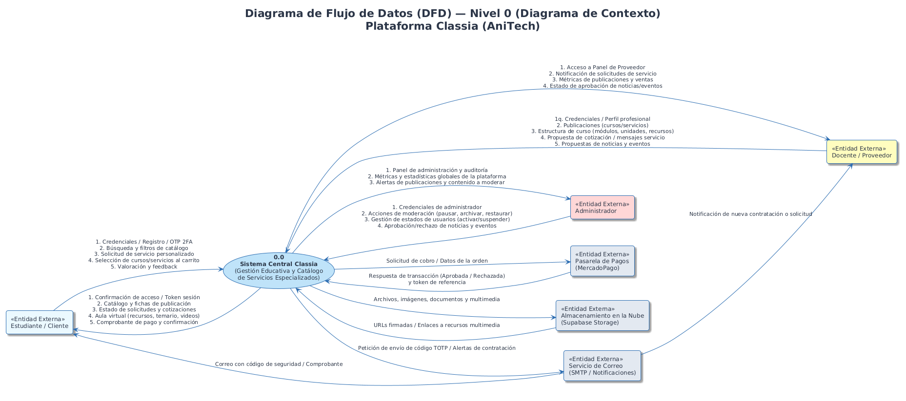
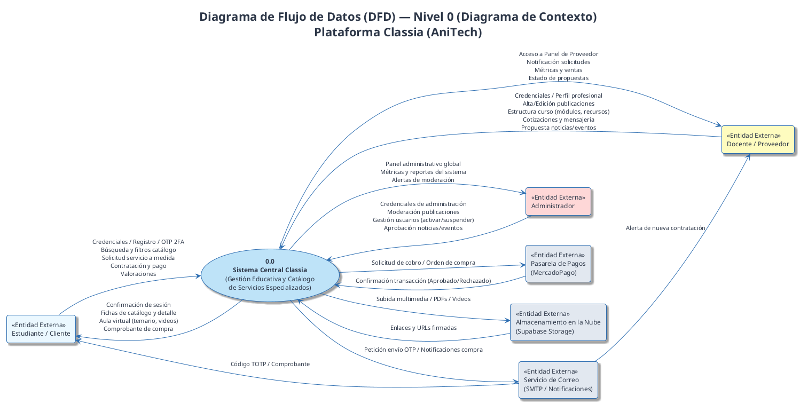
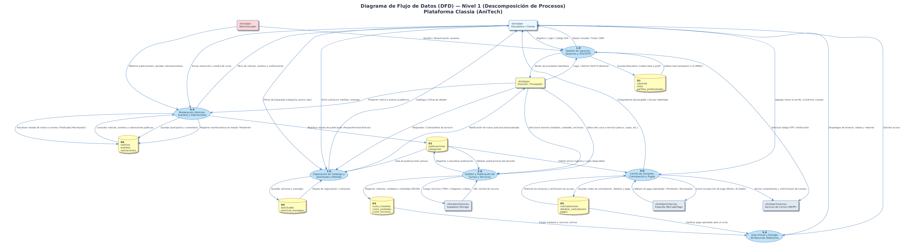

# Diagrama de Flujo de Datos (DFD) — Classia · Sprint 4 (Octubre 2026)

Este documento describe el flujo de información de la plataforma web **Classia** (desarrollada por **AniTech**), estructurado según la metodología clásica de análisis estructurado (Gane & Sarson / Yourdon & DeMarco) en dos niveles:
1. **Nivel 0 (Diagrama de Contexto):** Delimita el límite del sistema respecto a los actores externos y servicios de terceros.
2. **Nivel 1 (Descomposición Funcional de Procesos):** Detalla los procesos lógicos principales, los almacenes de datos persistentes y los flujos que los conectan.

---

## 1. DFD Nivel 0 — Diagrama de Contexto

El Diagrama de Contexto representa a Classia como un único proceso central (**0.0**) que interactúa con tres tipos de usuarios y tres servicios externos.

*Versión vectorial:* [dfd_nivel_0_contexto.svg](diagramas/dfd_nivel_0_contexto.svg) | *Código fuente:* [dfd_nivel_0_contexto.puml](diagramas/dfd_nivel_0_contexto.puml)

---

## 2. DFD Nivel 1 — Descomposición en Procesos Principales

En este nivel se descompone el sistema en 6 subsistemas o procesos principales, relacionándose con los almacenes de datos de la base de datos relacional de Classia:

*Versión vectorial:* [dfd_nivel_1_procesos.svg](diagramas/dfd_nivel_1_procesos.svg) | *Código fuente:* [dfd_nivel_1_procesos.puml](diagramas/dfd_nivel_1_procesos.puml)

### Elementos del Diagrama:

- **Procesos:**
  - `1.0 Gestión de Usuarios, Sesiones y 2FA/TOTP`: Manejo de registro, inicio de sesión seguro, control RBAC y token CSRF.
  - `2.0 Gestión y Publicación de Cursos y Servicios`: Creación y edición con regla RD-09, temarios y recursos didácticos.
  - `3.0 Exploración de Catálogo y Solicitudes a Medida`: Búsquedas indexadas, filtros y cotización de servicios personalizados.
  - `4.0 Carrito de Compras, Contratación y Pagos`: Procesamiento con MercadoPago, verificación de montos y comprobantes.
  - `5.0 Aula Virtual y Entrega de Recursos Didácticos`: Control de acceso por pago aprobado, visualización de módulos, videos y archivos.
  - `6.0 Moderación, Noticias, Eventos y Valoraciones`: Aprobación por administrador, cálculo de promedios de satisfacción y difusión.

- **Almacenes de Datos (Data Stores):**
  - **D1:** `usuarios`, `roles`, `perfiles_profesionales`
  - **D2:** `publicaciones`, `categorias`
  - **D3:** `curso_modulos`, `curso_unidades`, `curso_recursos`
  - **D4:** `solicitudes`, `solicitud_mensajes`
  - **D5:** `contrataciones`, `detalles_contratacion`, `pagos`
  - **D6:** `noticias`, `eventos`, `valoraciones`

---

## 3. Matriz de Trazabilidad de Flujos de Datos

| Proceso | Flujo de Entrada | Origen | Flujo de Salida | Destino | Almacén Implicado |
| :--- | :--- | :--- | :--- | :--- | :--- |
| **1.0 Autenticación y Usuarios** | Credenciales, OTP 2FA | Estudiante / Docente / Admin | Token sesión, JWT/CSRF | Usuario / Navegador | `D1: Usuarios y Perfiles` |
| **2.0 Publicaciones y Temario** | Formulario publicación, módulos | Docente | Publicación activa / URLs | Docente / Catálogo | `D2: Publicaciones`, `D3: Temario` |
| **3.0 Catálogo y Solicitudes** | Filtros, requerimiento a medida | Estudiante | Ficha de oferta, presupuesto | Estudiante / Docente | `D2: Publicaciones`, `D4: Solicitudes` |
| **4.0 Carrito y Pagos** | Items seleccionados, pago | Estudiante / MercadoPago | Comprobante, orden aprobada | Estudiante / Correo | `D5: Contrataciones y Pagos` |
| **5.0 Aula Virtual** | Petición de unidad/video | Estudiante matriculado | Material didáctico, player | Estudiante | `D3: Temario`, `D5: Pagos` |
| **6.0 Moderación y Contenido** | Reseña, propuesta evento | Estudiante / Docente / Admin | Aprobación / Feedback público | Portal público | `D6: Noticias, Eventos y Reseñas` |
