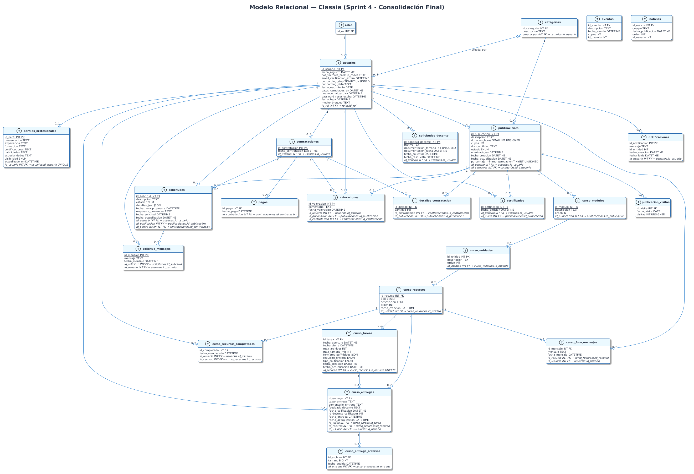

# Modelo Relacional — Classia · Sprint 4 (Octubre 2026)

## Especificación del Esquema Físico
Este documento detalla el **Modelo Relacional Lógico y Físico** correspondiente a la base de datos MariaDB / MySQL de la plataforma **Classia**.

> **Última actualización:** Sprint 4 — Octubre 2026  
> **Script físico asociado:** [`sql/schema.sql`](../sql/schema.sql) y [`sql/schema_supabase.sql`](../sql/schema_supabase.sql)

---

## Diagrama del Modelo Relacional (PlantUML / draw.io)

*Versión vectorial:* [modelo_relacional_classia.svg](diagramas/modelo_relacional_classia.svg) | *Código fuente:* [modelo_relacional_classia.puml](diagramas/modelo_relacional_classia.puml)

### Código Fuente PlantUML

```plantuml
@startuml modelo_relacional_classia
!theme plain

skinparam backgroundColor #FFFFFF
skinparam shadowing true
skinparam roundcorner 8
skinparam defaultFontName 'Segoe UI', 'Helvetica', 'Arial', sans-serif
skinparam defaultFontSize 12
skinparam defaultFontColor #2D3748

skinparam class {
    BackgroundColor #FFFFFF
    ArrowColor #3182CE
    BorderColor #2B6CB0
    HeaderBackgroundColor #EBF8FF
}
skinparam entity {
    BackgroundColor #FFFFFF
    BorderColor #2B6CB0
}
skinparam sequence {
    ActorBorderColor #2B6CB0
    ActorBackgroundColor #EBF8FF
    ParticipantBorderColor #2B6CB0
    ParticipantBackgroundColor #EBF8FF
    LifeLineBorderColor #4A5568
    LifeLineBackgroundColor #EDF2F7
    ArrowColor #2B6CB0
}
skinparam usecase {
    BackgroundColor #FFFFFF
    BorderColor #2B6CB0
    ArrowColor #3182CE
    ActorBorderColor #2B6CB0
    ActorBackgroundColor #EBF8FF
}

title Modelo Relacional Físico — Classia (MariaDB / MySQL) — Sprint 4

class "roles" as roles {
  + **id_rol** : INT [PK, AI]
  --
  nombre_rol : VARCHAR(50) [UQ, NN]
  descripcion : VARCHAR(255)
}

class "usuarios" as usuarios {
  + **id_usuario** : INT [PK, AI]
  --
  nombre : VARCHAR(100) [NN]
  apellido : VARCHAR(100) [NN]
  email : VARCHAR(150) [UQ, NN]
  password_hash : VARCHAR(255) [NN]
  telefono : VARCHAR(30)
  fecha_registro : DATETIME [NN]
  # **id_rol** : INT [FK, NN]
  foto_perfil : VARCHAR(255)
  dos_factores_activo : TINYINT(1) [NN]
  activo : TINYINT(1) [NN]
}

class "perfiles_profesionales" as perfiles {
  + **id_perfil** : INT [PK, AI]
  --
  # **id_usuario** : INT [FK, UQ, NN]
  titulo_profesional : VARCHAR(180)
  presentacion : TEXT
  experiencia : TEXT
  formacion : TEXT
  habilidades : TEXT
  especialidades : TEXT
  ubicacion : VARCHAR(150)
  modalidad_trabajo : VARCHAR(150)
}

class "categorias" as categorias {
  + **id_categoria** : INT [PK, AI]
  --
  nombre_categoria : VARCHAR(100) [UQ, NN]
  descripcion : TEXT
  # **creada_por** : INT [FK, NULL]
}

class "publicaciones" as publicaciones {
  + **id_publicacion** : INT [PK, AI]
  --
  titulo : VARCHAR(200) [NN]
  descripcion : TEXT [NN]
  precio : DECIMAL(10,2) [NN]
  tipo : ENUM('Curso', 'Servicio') [NN]
  modalidad : VARCHAR(30)
  duracion_horas : SMALLINT
  cupos : INT
  estado : ENUM('Activo', 'Inactivo', 'Pausado', 'Archivado', 'Eliminado') [NN]
  imagen : VARCHAR(255)
  porcentaje_minimo_aprobacion : TINYINT UNSIGNED [NN, DEFAULT 70]
  # **id_usuario** : INT [FK, NN]
  # **id_categoria** : INT [FK, NN]
}

class "curso_modulos" as modulos {
  + **id_modulo** : INT [PK, AI]
  --
  # **id_publicacion** : INT [FK, NN]
  titulo : VARCHAR(180) [NN]
  descripcion : TEXT
  orden : INT [NN]
}

class "curso_unidades" as unidades {
  + **id_unidad** : INT [PK, AI]
  --
  # **id_modulo** : INT [FK, NN]
  titulo : VARCHAR(180) [NN]
  descripcion : TEXT
  orden : INT [NN]
}

class "curso_recursos" as recursos {
  + **id_recurso** : INT [PK, AI]
  --
  # **id_unidad** : INT [FK, NN]
  titulo : VARCHAR(180) [NN]
  tipo : ENUM('Archivo','Foro','Entrega de Tareas','Video','PDF','Imagen','Enlace') [NN]
  url : VARCHAR(500)
  archivo : VARCHAR(255)
  orden : INT [NN]
  visible_alumnos : TINYINT(1) [NN, DEFAULT 1]
}

class "curso_tareas" as tareas {
  + **id_tarea** : INT [PK, AI]
  --
  # **id_recurso** : INT [FK, NN]
  # **id_publicacion** : INT [FK, NN]
  titulo : VARCHAR(180) [NN]
  descripcion : TEXT
  fecha_limite : DATETIME
  permite_entrega_tardia : TINYINT(1) [NN, DEFAULT 0]
  nota_maxima : DECIMAL(5,2) [NN, DEFAULT 100.00]
}

class "curso_entregas" as entregas {
  + **id_entrega** : INT [PK, AI]
  --
  # **id_tarea** : INT [FK, NN]
  # **id_usuario** : INT [FK, NN]
  comentario : TEXT
  nota : DECIMAL(5,2)
  estado : ENUM('Pendiente','Revisada','Aprobada','Rechazada') [NN]
  fecha_entrega : DATETIME [NN]
}

class "curso_entrega_archivos" as entrega_archivos {
  + **id_archivo** : INT [PK, AI]
  --
  # **id_entrega** : INT [FK, NN]
  nombre_archivo : VARCHAR(255) [NN]
  ruta_archivo : VARCHAR(500) [NN]
  tipo_mime : VARCHAR(100)
  tamano_bytes : INT
}

class "curso_recursos_completados" as recursos_completados {
  + **id_completado** : INT [PK, AI]
  --
  # **id_recurso** : INT [FK, NN]
  # **id_usuario** : INT [FK, NN]
  completado_en : DATETIME [NN]
}

class "certificados" as certificados {
  + **id_certificado** : INT [PK, AI]
  --
  # **id_usuario** : INT [FK, NN]
  # **id_publicacion** : INT [FK, NN]
  codigo_verificacion : VARCHAR(64) [NN, UNIQUE]
  fecha_emision : DATETIME [NN]
  progreso_al_emitir : TINYINT UNSIGNED [NN]
}

class "curso_foro_mensajes" as foro {
  + **id_mensaje** : INT [PK, AI]
  --
  # **id_recurso** : INT [FK, NN]
  # **id_usuario** : INT [FK, NN]
  id_mensaje_padre : INT [FK, NULL]
  contenido : TEXT [NN]
  fecha_mensaje : DATETIME [NN]
}

class "notificaciones" as notificaciones {
  + **id_notificacion** : INT [PK, AI]
  --
  # **id_usuario** : INT [FK, NN]
  tipo : VARCHAR(50) [NN]
  titulo : VARCHAR(200) [NN]
  mensaje : TEXT [NN]
  leida : TINYINT(1) [NN, DEFAULT 0]
  url_accion : VARCHAR(500)
  creada_en : DATETIME [NN]
}

class "solicitudes" as solicitudes {
  + **id_solicitud** : INT [PK, AI]
  --
  titulo : VARCHAR(200) [NN]
  descripcion : TEXT [NN]
  estado : ENUM('Pendiente', 'Aceptada', 'Rechazada', 'Contraoferta', 'En Proceso', 'Realizada', 'Cancelada') [NN]
  precio_propuesto : DECIMAL(10,2)
  # **id_usuario** : INT [FK, NN]
  # **id_publicacion** : INT [FK, NULL]
}

class "solicitud_mensajes" as mensajes {
  + **id_mensaje** : INT [PK, AI]
  --
  # **id_solicitud** : INT [FK, NN]
  # **id_usuario** : INT [FK, NN]
  mensaje : TEXT [NN]
  fecha_mensaje : DATETIME [NN]
}

class "contrataciones" as contrataciones {
  + **id_contratacion** : INT [PK, AI]
  --
  fecha_contratacion : DATETIME [NN]
  monto_total : DECIMAL(10,2) [NN]
  estado : ENUM('Pendiente', 'En Proceso', 'Completada', 'Cancelada') [NN]
  # **id_usuario** : INT [FK, NN]
}

class "detalles_contratacion" as detalles {
  + **id_detalle** : INT [PK, AI]
  --
  cantidad : INT [NN]
  precio_unitario : DECIMAL(10,2) [NN]
  subtotal : DECIMAL(10,2) [NN]
  # **id_contratacion** : INT [FK, NN]
  # **id_publicacion** : INT [FK, NN]
}

class "pagos" as pagos {
  + **id_pago** : INT [PK, AI]
  --
  monto : DECIMAL(10,2) [NN]
  metodo_pago : ENUM('Tarjeta', 'Transferencia', 'MercadoPago', 'Efectivo') [NN]
  estado_pago : ENUM('Pendiente', 'Aprobado', 'Rechazado') [NN]
  transaccion_ref : VARCHAR(100)
  # **id_contratacion** : INT [FK, NN]
}

class "noticias" as noticias {
  + **id_noticia** : INT [PK, AI]
  --
  titulo : VARCHAR(200) [NN]
  contenido : TEXT [NN]
  imagen : VARCHAR(255)
  estado : ENUM('Pendiente', 'Publicada', 'Rechazada') [NN]
  # **id_usuario** : INT [FK, NN]
  fecha_publicacion : DATETIME
}

class "eventos" as eventos {
  + **id_evento** : INT [PK, AI]
  --
  titulo : VARCHAR(200) [NN]
  descripcion : TEXT [NN]
  imagen : VARCHAR(255)
  estado : ENUM('Pendiente', 'Abierto', 'Rechazado', 'Finalizado') [NN]
  # **id_usuario** : INT [FK, NN]
  fecha_inicio : DATETIME [NN]
  fecha_fin : DATETIME
}

class "valoraciones" as valoraciones {
  + **id_valoracion** : INT [PK, AI]
  --
  puntuacion : INT [NN]
  comentario : TEXT
  # **id_usuario** : INT [FK, NN]
  # **id_publicacion** : INT [FK, NN]
  # **id_contratacion** : INT [FK, NULL]
}

roles "1" <-- "0..*" usuarios : id_rol
usuarios "1" <-- "0..1" perfiles : id_usuario
usuarios "1" <-- "0..*" categorias : creada_por
usuarios "1" <-- "0..*" publicaciones : id_usuario
categorias "1" <-- "0..*" publicaciones : id_categoria

publicaciones "1" <-- "0..*" modulos : id_publicacion
modulos "1" <-- "0..*" unidades : id_modulo
unidades "1" <-- "0..*" recursos : id_unidad
recursos "1" <-- "0..*" tareas : id_recurso
publicaciones "1" <-- "0..*" tareas : id_publicacion
tareas "1" <-- "0..*" entregas : id_tarea
usuarios "1" <-- "0..*" entregas : id_usuario
entregas "1" <-- "0..*" entrega_archivos : id_entrega
recursos "1" <-- "0..*" recursos_completados : id_recurso
usuarios "1" <-- "0..*" recursos_completados : id_usuario
usuarios "1" <-- "0..*" certificados : id_usuario
publicaciones "1" <-- "0..*" certificados : id_publicacion
recursos "1" <-- "0..*" foro : id_recurso
usuarios "1" <-- "0..*" foro : id_usuario
foro "0..1" <-- "0..*" foro : id_mensaje_padre
usuarios "1" <-- "0..*" notificaciones : id_usuario

usuarios "1" <-- "0..*" solicitudes : id_usuario
publicaciones "0..1" <-- "0..*" solicitudes : id_publicacion
solicitudes "1" <-- "0..*" mensajes : id_solicitud
usuarios "1" <-- "0..*" mensajes : id_usuario

usuarios "1" <-- "0..*" contrataciones : id_usuario
contrataciones "1" <-- "1..*" detalles : id_contratacion
publicaciones "1" <-- "0..*" detalles : id_publicacion
contrataciones "1" <-- "0..*" pagos : id_contratacion

usuarios "1" <-- "0..*" valoraciones : id_usuario
publicaciones "1" <-- "0..*" valoraciones : id_publicacion
contrataciones "0..1" <-- "0..*" valoraciones : id_contratacion

usuarios "1" <-- "0..*" noticias : id_usuario
usuarios "1" <-- "0..*" eventos : id_usuario
@enduml

```

---

## Tablas y Claves Foráneas

1. `roles` (**id_rol** [PK])
2. `usuarios` (**id_usuario** [PK], `id_rol` [FK -> roles])
3. `perfiles_profesionales` (**id_perfil** [PK], `id_usuario` [FK UNIQUE -> usuarios])
4. `categorias` (**id_categoria** [PK], `creada_por` [FK -> usuarios])
5. `publicaciones` (**id_publicacion** [PK], `id_usuario` [FK -> usuarios], `id_categoria` [FK -> categorias])
6. `curso_modulos` (**id_modulo** [PK], `id_publicacion` [FK -> publicaciones])
7. `curso_unidades` (**id_unidad** [PK], `id_modulo` [FK -> curso_modulos])
8. `curso_recursos` (**id_recurso** [PK], `id_unidad` [FK -> curso_unidades])
9. `curso_tareas` (**id_tarea** [PK], `id_recurso` [FK -> curso_recursos], `id_publicacion` [FK -> publicaciones]) *(Sprint 3-4)*
10. `curso_entregas` (**id_entrega** [PK], `id_tarea` [FK -> curso_tareas], `id_usuario` [FK -> usuarios]) *(Sprint 3-4)*
11. `curso_entrega_archivos` (**id_archivo** [PK], `id_entrega` [FK -> curso_entregas]) *(Sprint 3-4)*
12. `curso_recursos_completados` (**id_completado** [PK], `id_recurso` [FK -> curso_recursos], `id_usuario` [FK -> usuarios]) *(Sprint 3-4)*
13. `certificados` (**id_certificado** [PK], `id_usuario` [FK -> usuarios], `id_publicacion` [FK -> publicaciones]) *(Sprint 3-4)*
14. `curso_foro_mensajes` (**id_mensaje** [PK], `id_recurso` [FK -> curso_recursos], `id_usuario` [FK -> usuarios], `id_mensaje_padre` [FK auto-ref NULL]) *(Sprint 3-4)*
15. `notificaciones` (**id_notificacion** [PK], `id_usuario` [FK -> usuarios]) *(Sprint 3-4)*
16. `solicitudes` (**id_solicitud** [PK], `id_usuario` [FK -> usuarios], `id_publicacion` [FK -> publicaciones])
17. `solicitud_mensajes` (**id_mensaje** [PK], `id_solicitud` [FK -> solicitudes], `id_usuario` [FK -> usuarios])
18. `solicitudes_docente` (**id_solicitud_docente** [PK], `id_usuario` [FK -> usuarios])
19. `contrataciones` (**id_contratacion** [PK], `id_usuario` [FK -> usuarios])
20. `detalles_contratacion` (**id_detalle** [PK], `id_contratacion` [FK -> contrataciones], `id_publicacion` [FK -> publicaciones])
21. `pagos` (**id_pago** [PK], `id_contratacion` [FK -> contrataciones])
22. `valoraciones` (**id_valoracion** [PK], `id_usuario` [FK -> usuarios], `id_publicacion` [FK -> publicaciones], `id_contratacion` [FK -> contrataciones])
23. `publicacion_visitas` (**id_visita** [PK], `id_publicacion` [FK -> publicaciones])
24. `noticias` (**id_noticia** [PK], `id_usuario` [FK -> usuarios])
25. `eventos` (**id_evento** [PK], `id_usuario` [FK -> usuarios])
26. `auditoria_seguridad` (**id_auditoria** [PK], `id_usuario` [FK NULL -> usuarios])
